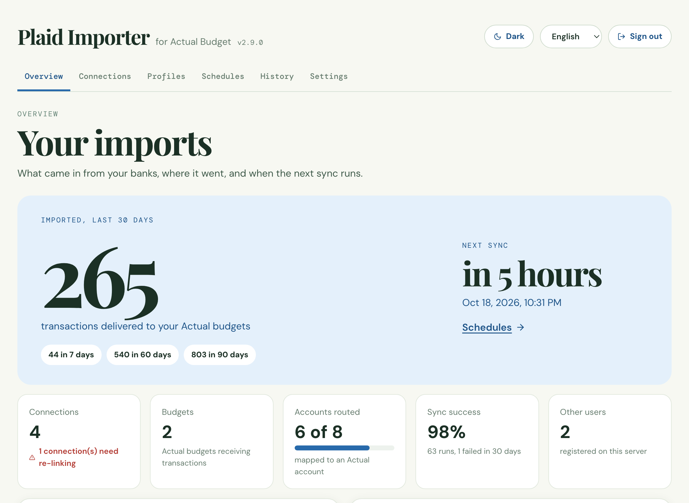
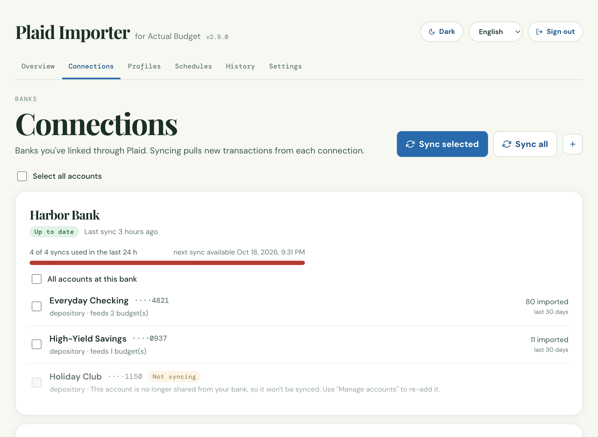
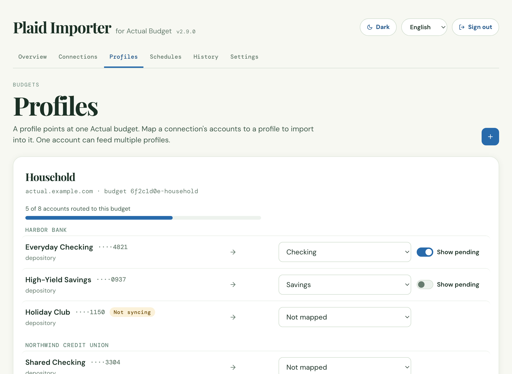
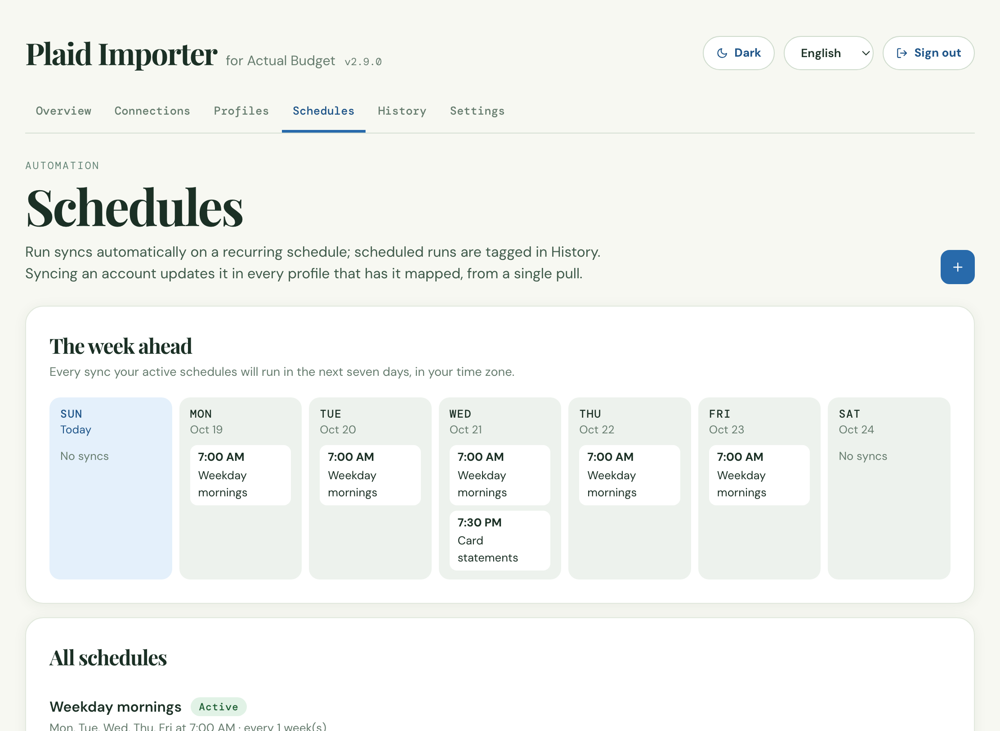
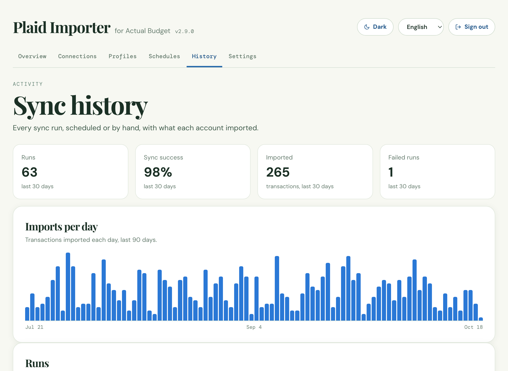
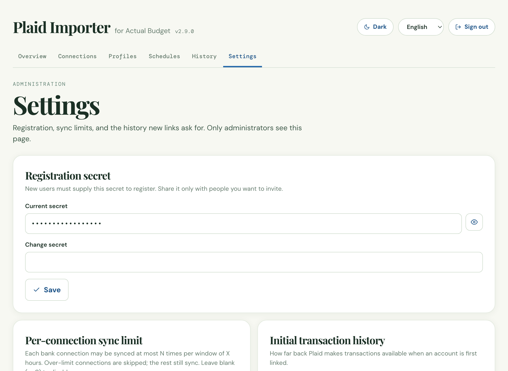

# Plaid Importer for Actual Budget

Self-hosted web app that pulls your bank transactions from
[Plaid](https://plaid.com/) into [Actual Budget](https://actualbudget.org/).

One Plaid pull per connection fans out to every budget that maps it, through a
local encrypted journal, so adding more budgets never costs more Plaid calls.

> **You bring your own Plaid credentials.** This app needs a Plaid `client_id` /
> `secret` with **production access** (Plaid's free tier is sandbox-only).
> Getting production access is between you and Plaid.
>
> **Serve it over HTTPS.** Plaid's OAuth banks require an HTTPS callback URL;
> without HTTPS only non-OAuth institutions can be linked. See [DEPLOY.md](DEPLOY.md).

## Features

- **At-a-glance overview**: transactions imported in the last 30 days (with
  7/60/90-day totals), the next scheduled sync, how many accounts are routed to
  a budget, your sync success rate, imports per day, imports by bank, and how
  fresh each bank's last sync is.
- **Health banners**: if a budget's last sync couldn't reach Actual, hit import
  errors, or a bank needs reconnecting, every page says so and links to the fix.
  Banners clear on their own after the next good sync.
- **Bank health**: each connection shows how recently it synced, how much of the
  sync limit it has used, which budgets each account feeds, and what each
  account imported in the last 30 days.
- **Routing view**: each profile shows bank account → Actual account rows and a
  meter of how many accounts it receives; changes save in place.
- **The week ahead**: the Schedules page lays out every sync your schedules will
  run in the next seven days.
- **Pending transactions**: set notes and categories on a pending transaction;
  they persist when it officially posts.
- **Multi-user**: built for a household. Family or roommates each get their own
  account, and per-profile Actual encryption keeps others out of your budget.
- **Multi-budget**: a "profile" points at one Actual budget; one bank account
  can feed several profiles at once.
- **Scheduled or on-demand**: pick which Plaid connections a schedule pulls and
  how often, give it a name, run as many schedules as you need, or sync on demand.
- **Per-connection sync limits**: cap how often a connection can be pulled in a
  window. Plaid bills per pull, so you get a lever for family/friends. (A
  connection is one institution, e.g. Wells Fargo, which may hold several accounts.)
- **Initial history depth**: choose how far back Plaid opens up transactions when
  a bank is first linked — 90 to 730 days, defaulting to Plaid's 90-day floor.
  Plaid fixes this at link time, so it applies to newly linked accounts only and
  won't backfill banks you've already connected.
- **Connection lifecycle**: when a connection errors because you changed your
  bank credentials, re-link it without losing your setup.
- **Manage accounts**: add or drop which accounts a connection shares without
  re-linking. Dropped accounts stop syncing but keep their mappings; re-added
  ones are reconciled so you don't get duplicates.
- **Sync history**: 30-day run summary, a 90-day imports chart, and every run
  with what each account imported and any failures.
- **Registration secret**: only people with the secret can register an account.
- **Admin controls**: the first account is admin and manages the registration
  secret, sync limits, initial history depth, and every profile.
- **Encryption**: Plaid tokens and profile secrets are encrypted at rest;
  transaction data is encrypted and short-lived.
- **Bilingual**: English and Spanish, switchable from the header.
- **Light and dark**: follows your system until you pick one.
- **Version on screen**: the running version shows next to the title in the top
  bar, so you always know which build you're on.
- **Unraid**: setup instructions in [DEPLOY.md](DEPLOY.md).

## Screenshots

Demo data throughout; regenerate with `./scripts/screenshots.sh`.








## Set up

You need a Docker host, an Actual Budget server, and Plaid production credentials.

1. Copy `.env.example` to `.env` and fill it in: Plaid keys, your Actual server
   URL + password, and two generated secrets (commands are in the file).
2. Run the container (see [DEPLOY.md](DEPLOY.md)) behind an HTTPS reverse proxy.
3. Open the app and **register**; the first account becomes the admin.
4. **Link a bank** (Plaid), create a **profile** for your Actual budget, **map**
   each account to an Actual account, and click **Sync**, or set a schedule.

That's it. Migrations and first-run setup happen automatically on boot.

## Develop

The app is a Fastify server (`src/`) with a React + Vite frontend (`web/`) for
the signed-in pages; sign-in pages are server-rendered. Run commands in the dev
container:

```bash
npm run dev          # Vite (:5173) and the server (:8080) together; open :8080
npm test && npm run typecheck && npm run build
```

In VS Code, the **dev: all** task runs `npm run dev`; **Debug: dev server**
starts Vite first, then the server under the debugger.

### Key settings (`.env`)

| Variable | What it does |
| --- | --- |
| `APP_URL` | Public HTTPS URL of the app (also the base of the Plaid OAuth redirect). |
| `PLAID_CLIENT_ID`, `PLAID_SECRET`, `PLAID_ENV` | Your Plaid credentials. Set `PLAID_ENV=production`. |
| `ACTUAL_SERVER_URL`, `ACTUAL_SERVER_PASSWORD` | Optional. Defaults the new profile form uses if you don't enter them (URL pre-filled; blank password falls back to this). Budgets are chosen per profile in the app. |
| `APP_USER`, `APP_PASSWORD` | Seed the first admin account. |
| `SESSION_SECRET` | Signs login cookies (`openssl rand -hex 32`). |
| `TOKEN_ENCRYPTION_KEY` | Encrypts Plaid tokens and profile secrets at rest (`openssl rand -base64 32`). Keep it stable; rotating it makes stored secrets unreadable. |

`APP_USER`/`APP_PASSWORD` are **seed-only**: on first boot they create your admin
account, then they're ignored. The `ACTUAL_*` values are optional defaults for
the New-profile form. Manage logins and budgets (profiles) in the app. Full list
with defaults is in [`.env.example`](.env.example).

## Credits

Styling and inspiration: [Immich Insights](https://github.com/laurinml/Immich-Insights)
by laurinml (MIT), by way of media-insights. Icons are [Feather](https://feathericons.com/)
(MIT); fonts are OFL. Notices: [THIRD_PARTY_NOTICES.txt](public/THIRD_PARTY_NOTICES.txt).

## License

[AGPL-3.0](LICENSE). If you run a modified version as a network service, you
must offer its source to users.
